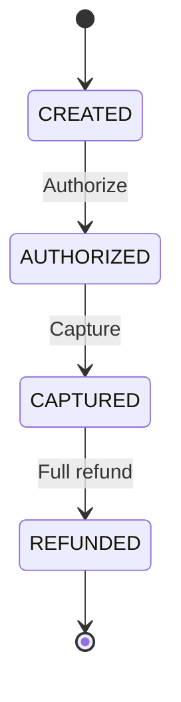
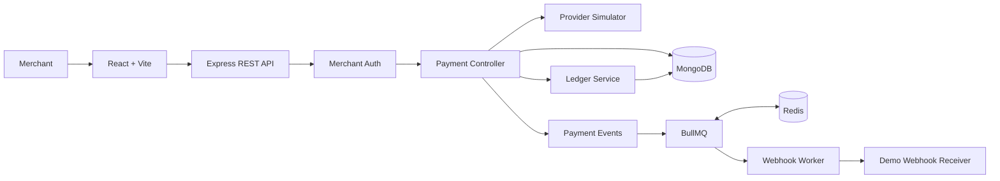

 <div align="center">

# PayFlow
### Intelligent Payment Reliability & Recovery Platform

**A payment-infrastructure simulator focused on reliable workflows, transaction consistency and asynchronous event delivery.**

[](https://react.dev/)
[](https://nodejs.org/)
[](https://expressjs.com/)
[](https://www.mongodb.com/)
[](https://redis.io/)
[](https://bullmq.io/)

</div>

---

<table>
<tr>
<td width="58%" valign="middle">

## Payments should be predictable—even when systems aren't.

A payment workflow is more than a successful API response. Requests can be retried, workers can fail, webhooks can be delayed, and financial records must remain consistent.

**PayFlow is a hands-on engineering project that explores those problems** through a merchant dashboard, REST API, simulated provider, MongoDB persistence, a Redis-backed job queue and a double-entry ledger.

It makes the important parts of a payment workflow visible: state changes, idempotency, event history, webhook attempts and ledger movements.

**The goal:** demonstrate the engineering patterns behind reliable payment operations—not imitate a real payment processor.

</td>
<td width="42%" align="center" valign="middle">

<a href="docs/images/tech-stack-orbit.gif">

</a>

<p align="center">
<sub><strong>TECHNOLOGY ECOSYSTEM</strong><br/>
Animated architecture · illustrating service relationships and interactions</sub>
</p>

</td>
</tr>
</table>

## At a glance

| Area | What PayFlow demonstrates |
|---|---|
| Payment lifecycle | Create → Authorize → Capture → Refund |
| Request reliability | Idempotency keys and payload conflict detection |
| Financial records | Balanced debit/credit journal entries |
| Event processing | Payment events and asynchronous webhook jobs |
| Delivery resilience | BullMQ retries with exponential backoff |
| Webhook integrity | HMAC-SHA256 signatures |
| Merchant access | Hashed demo API keys and bearer authentication |
| Persistence | MongoDB replica-set transactions |

## Product workflow



Each successful transition is recorded as a payment event. Capture and refund operations also create ledger entries. Unsupported transitions are rejected by the API.

## Core capabilities

### 01 — Payment lifecycle

Create a payment, authorize it, capture the authorized amount and issue a full refund. The API enforces supported state transitions instead of allowing arbitrary status updates.

### 02 — Idempotent payment creation

The create-payment endpoint accepts an `Idempotency-Key`. PayFlow hashes the normalized request payload, associates the key with the merchant and detects attempts to reuse the same key with a different request body.

### 03 — Double-entry ledger

Capture and refund operations produce debit and credit journal entries. The ledger service validates that each journal entry balances before it is persisted.

### 04 — Asynchronous webhook delivery

Payment events are queued through BullMQ and Redis. Delivery attempts are recorded, and failed jobs can be retried using exponential backoff.

### 05 — Webhook signing

Outgoing demo webhooks are signed with HMAC-SHA256. The signature is sent in the `X-PayFlow-Signature` header and is calculated over the exact raw request bytes.

### 06 — Merchant API authentication

A seed script creates a demo merchant and prints its API key once. The application stores the SHA-256 hash rather than the plaintext key. Merchant endpoints use bearer-token authentication.

### 07 — Merchant dashboard

The React dashboard supports payment creation and listing, authorization, capture, full refunds, payment event inspection, ledger review and webhook delivery monitoring.

## Architecture



### Request path

1. The dashboard sends a request to the Express API.
2. Authentication middleware validates the merchant API key.
3. Zod validates the request payload.
4. Idempotency logic checks for a previous request with the same key.
5. The payment controller invokes the simulated provider for the relevant operation.
6. MongoDB persists payment, event and ledger changes using replica-set transactions where implemented.
7. BullMQ handles asynchronous webhook delivery and retry scheduling.
8. The dashboard retrieves updated payment, ledger and delivery records.

## Technology choices

| Technology | Role in this project |
|---|---|
| React 18 | Merchant dashboard UI |
| Vite 5 | Frontend development server and build |
| Node.js 20+ | Backend runtime |
| Express 4 | REST API and middleware |
| MongoDB 7 | Payments, events, merchants, ledger and delivery records |
| Mongoose 8 | MongoDB models and transaction support |
| Redis 7 | BullMQ queue storage |
| BullMQ 5 | Background webhook jobs and retries |
| Zod | Request validation |
| Helmet | HTTP security headers |
| express-rate-limit | API rate limiting |
| ioredis | Redis client |
| Docker Compose | Local MongoDB and Redis services |
| Node.js crypto | SHA-256 hashing and HMAC-SHA256 signatures |

## Repository layout

```text
PayFlow/
├── client/
│   └── src/
│       ├── App.jsx
│       ├── api.js
│       ├── main.jsx
│       └── styles.css
├── server/
│   ├── src/
│   │   ├── config/          # MongoDB and Redis connections
│   │   ├── controllers/     # Payment request handlers
│   │   ├── middleware/      # Authentication and error handling
│   │   ├── models/          # Mongoose schemas
│   │   ├── routes/          # API routes
│   │   ├── scripts/         # Demo merchant seed script
│   │   ├── services/        # Provider, ledger and webhook logic
│   │   ├── utils/           # Hashing helpers
│   │   ├── app.js
│   │   └── server.js
│   └── tests/
├── docs/
│   ├── images/
│   │   └── tech-stack-orbit.gif
│   └── PayFlow.postman_collection.json
├── docker-compose.yml
├── mongo-init.js
└── README.md
```

## Run locally

### Prerequisites

- Node.js 20 or later
- npm
- Docker Desktop
- Git (optional, for cloning)

Verify:

```bash
node --version
npm --version
docker --version
```

### 1. Get the source

```bash
git clone https://github.com/YOUR_USERNAME/PayFlow.git
cd PayFlow
```

Or download the repository ZIP and open the extracted folder in VS Code.

### 2. Start infrastructure

From the project root:

```bash
docker compose up -d
```

This starts MongoDB 7 on `localhost:27017` and Redis 7 on `localhost:6379`. The MongoDB container is configured as a single-node replica set named `rs0`, required for the transaction workflow.

Check status:

```bash
docker compose ps
```

### 3. Configure and seed the backend

```bash
cd server
```

Create the environment file.

**Windows PowerShell:**

```powershell
Copy-Item .env.example .env
```

**macOS / Linux:**

```bash
cp .env.example .env
```

Example `.env`:

```env
PORT=5001
MONGODB_URI=mongodb://127.0.0.1:27017/payflow_db?replicaSet=rs0
REDIS_URL=redis://127.0.0.1:6379
CLIENT_ORIGIN=http://localhost:5173
WEBHOOK_SECRET=replace-with-a-long-random-secret
DEMO_MERCHANT_NAME=PayFlow Demo Merchant
```

Use a unique local webhook secret and keep `.env` out of version control.

Install dependencies and create the demo merchant:

```bash
npm install
npm run seed
```

The seed command prints a generated API key. **Copy it when displayed**; the database stores its hash, not the plaintext value.

Start the API:

```bash
npm run dev
```

Health check: `http://localhost:5001/api/health`

### 4. Start the frontend

Open a second terminal from the project root:

```bash
cd client
```

Create the environment file.

**Windows PowerShell:**

```powershell
Copy-Item .env.example .env
```

**macOS / Linux:**

```bash
cp .env.example .env
```

Install and run:

```bash
npm install
npm run dev
```

Open `http://localhost:5173` and enter the demo merchant API key generated earlier.

## Try a payment

All merchant endpoints require:

```http
Authorization: Bearer YOUR_API_KEY
```

Create a payment:

```bash
curl -X POST http://localhost:5001/api/v1/payments \
  -H "Content-Type: application/json" \
  -H "Authorization: Bearer YOUR_API_KEY" \
  -H "Idempotency-Key: order-demo-0001" \
  -d '{
    "amount": 12500,
    "currency": "INR",
    "description": "Demo purchase",
    "customerReference": "CUSTOMER-001"
  }'
```

Amounts are integers in the smallest currency unit: `12500` represents ₹125.00.

Use the returned payment ID:

```bash
# Authorize
curl -X POST http://localhost:5001/api/v1/payments/PAYMENT_ID/authorize \
  -H "Authorization: Bearer YOUR_API_KEY"

# Capture
curl -X POST http://localhost:5001/api/v1/payments/PAYMENT_ID/capture \
  -H "Authorization: Bearer YOUR_API_KEY"

# Full refund
curl -X POST http://localhost:5001/api/v1/payments/PAYMENT_ID/refund \
  -H "Authorization: Bearer YOUR_API_KEY"
```

Replace `PAYMENT_ID` and `YOUR_API_KEY` with your local values.

## API reference

| Method | Endpoint | Purpose |
|---|---|---|
| `GET` | `/api/health` | API health check |
| `POST` | `/api/v1/payments` | Create payment |
| `GET` | `/api/v1/payments` | List payments |
| `GET` | `/api/v1/payments/:id` | Retrieve payment |
| `POST` | `/api/v1/payments/:id/authorize` | Authorize payment |
| `POST` | `/api/v1/payments/:id/capture` | Capture payment |
| `POST` | `/api/v1/payments/:id/refund` | Full refund |
| `GET` | `/api/v1/payments/:id/events` | Payment event history |
| `GET` | `/api/v1/ledger` | Ledger entries |
| `GET` | `/api/v1/webhook-deliveries` | Webhook delivery records |

A Postman collection is included at `docs/PayFlow.postman_collection.json`.

## Engineering notes

**Why idempotency?** Clients may retry requests after timeouts or lost responses. An idempotency key helps recognize a retry and avoid creating a second payment for the same logical request.

**Why a queue?** Webhook delivery is an external side effect. Queueing separates delivery work from the main request path and provides a place to apply retry policies.

**Why a ledger?** A payment status alone does not explain the financial movement. Debit and credit entries provide a record that can be inspected and reconciled.

**Why a replica set locally?** MongoDB multi-document transactions require a replica set. Docker Compose starts a single-node replica set for local development.

## Tests

Run backend tests from `server`:

```bash
npm test
```

Build the frontend from `client`:

```bash
npm run build
```

## Roadmap

Future enhancements—not current capabilities:

- [ ] PayPal Sandbox provider adapter using OAuth and the Orders API
- [ ] Merchant registration and secure user sessions
- [ ] Partial refunds and refund-specific idempotency
- [ ] Merchant-configurable webhook endpoints
- [ ] More integration and failure-path tests
- [ ] Structured logs and operational metrics
- [ ] CI workflow and cloud deployment

## Scope and limitations

PayFlow is an educational payment infrastructure simulator. Its default provider is deterministic and simulated; it does not move real money and is not connected to live PayPal processing. PayPal Sandbox integration is a future milestone.

The project does not store card data and does not claim PCI DSS compliance. The current MVP supports full refunds only. Use synthetic test information and never enter real customer payment details or production credentials.

## Contributing

1. Fork the repository.
2. Create a focused feature branch.
3. Make and test your change.
4. Open a pull request with a clear description.

---

<div align="center">

**PayFlow**  
*Reliable workflows. Consistent records. Resilient payment operations.*

Built as a fintech engineering portfolio project.

</div>
