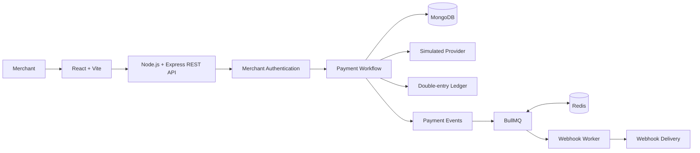
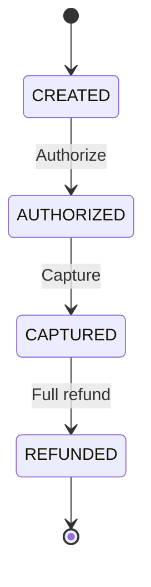

[README.md](https://github.com/user-attachments/files/34860191/README.md)
<div align="center">

# PayFlow
### Intelligent Payment Reliability & Recovery Platform

A full-stack fintech simulator demonstrating reliable payment workflows, transaction consistency, and asynchronous event delivery.

[](https://react.dev/)
[](https://nodejs.org/)
[](https://expressjs.com/)
[](https://www.mongodb.com/)
[](https://redis.io/)
[](https://bullmq.io/)

[Overview](#overview) · [Dashboard](#github-dashboard) · [Architecture](#architecture) · [Run locally](#run-locally) · [API](#api-reference)

</div>

---

## Overview

PayFlow is a payment-infrastructure portfolio project built around a simulated payment provider. It demonstrates how a payment application can handle retries, state transitions, financial records, and asynchronous webhook delivery.

<table>
<tr>
<td width="58%" valign="middle">

### Built around reliability

- **Payment lifecycle:** Create, authorize, capture, and full refund.
- **Idempotency:** Detect duplicate requests and conflicting payloads.
- **Double-entry ledger:** Record balanced debit and credit movements.
- **Webhook processing:** Queue event delivery with BullMQ and Redis.
- **Delivery retries:** Retry failed webhook jobs with backoff.
- **Webhook integrity:** Sign outgoing payloads with HMAC-SHA256.
- **Merchant access:** Hashed demo API keys and bearer authentication.

</td>
<td width="42%" align="center" valign="middle">


<sub><strong>PAYFLOW · SYSTEM ARCHITECTURE</strong><br/>Animated service-flow illustration · not live production telemetry</sub>

</td>
</tr>
</table>

## GitHub dashboard

<div align="center">

### Repository activity

[](https://github.com/YOUR_GITHUB_USERNAME/PayFlow/stargazers)
[](https://github.com/YOUR_GITHUB_USERNAME/PayFlow/forks)
[](https://github.com/YOUR_GITHUB_USERNAME/PayFlow/issues)
[](https://github.com/YOUR_GITHUB_USERNAME/PayFlow/commits/main)

<table>
<tr>
<td width="50%">

</td>
<td width="50%">

</td>
</tr>
<tr>
<td colspan="2" align="center">

</td>
</tr>
</table>

<sub>GitHub cards are fetched from third-party services and may be cached. Repository badges reflect the public GitHub repository; profile cards reflect the account, not live PayFlow server telemetry.</sub>

</div>

## Architecture



### Payment lifecycle



## Technology stack

| Layer | Technologies |
|---|---|
| Frontend | React 18, Vite, JavaScript, CSS |
| Backend | Node.js, Express, REST APIs |
| Database | MongoDB, Mongoose |
| Background jobs | Redis, BullMQ |
| Reliability & security | Idempotency keys, HMAC-SHA256, API key hashing, Zod, Helmet, rate limiting |
| Infrastructure | Docker Compose |

## Run locally

### Prerequisites

- Node.js 20+
- npm
- Docker Desktop

### 1. Clone the repository

```bash
git clone https://github.com/YOUR_GITHUB_USERNAME/PayFlow.git
cd PayFlow
```

### 2. Start MongoDB and Redis

From the project root:

```bash
docker compose up -d
docker compose ps
```

MongoDB is configured as a single-node replica set (`rs0`) for local transaction support.

### 3. Configure and start the backend

```bash
cd server
```

Create `.env` from the example file.

**Windows PowerShell**
```powershell
Copy-Item .env.example .env
```

**macOS / Linux**
```bash
cp .env.example .env
```

Example configuration (use the actual variable names from your `.env.example`):

```env
PORT=5001
MONGODB_URI=mongodb://127.0.0.1:27017/payflow_db?replicaSet=rs0
REDIS_URL=redis://127.0.0.1:6379
CLIENT_ORIGIN=http://localhost:5173
WEBHOOK_SECRET=replace-with-a-long-random-secret
DEMO_MERCHANT_NAME=PayFlow Demo Merchant
```

Install, seed the demo merchant, and run:

```bash
npm install
npm run seed
npm run dev
```

Copy the generated demo API key printed by the seed command. The API health endpoint is `http://localhost:5001/api/health`.

### 4. Configure and start the frontend

Open a second terminal from the project root:

```bash
cd client
```

Create the frontend `.env` file using the same approach:

**Windows PowerShell**
```powershell
Copy-Item .env.example .env
```

**macOS / Linux**
```bash
cp .env.example .env
```

Then:

```bash
npm install
npm run dev
```

Open `http://localhost:5173` and use the demo merchant API key.

## API reference

Merchant endpoints require:

```http
Authorization: Bearer YOUR_API_KEY
```

| Method | Endpoint | Purpose |
|---|---|---|
| `GET` | `/api/health` | Health check |
| `POST` | `/api/v1/payments` | Create a payment |
| `GET` | `/api/v1/payments` | List payments |
| `GET` | `/api/v1/payments/:id` | Get payment details |
| `POST` | `/api/v1/payments/:id/authorize` | Authorize |
| `POST` | `/api/v1/payments/:id/capture` | Capture |
| `POST` | `/api/v1/payments/:id/refund` | Full refund |
| `GET` | `/api/v1/payments/:id/events` | Payment event history |
| `GET` | `/api/v1/ledger` | Ledger entries |
| `GET` | `/api/v1/webhook-deliveries` | Webhook delivery records |

A Postman collection is available at `docs/PayFlow.postman_collection.json`.

## Project structure

```text
PayFlow/
├── client/
├── server/
├── docs/
│   ├── images/
│   │   └── payflow-architecture-flow.gif
│   └── PayFlow.postman_collection.json
├── docker-compose.yml
├── mongo-init.js
└── README.md
```

## Scope and limitations

PayFlow uses a deterministic simulated payment provider. It does **not** move real money and is not connected to live PayPal processing. PayPal Sandbox support is a possible future enhancement. The current workflow supports full refunds only and is intended for learning and portfolio demonstration.

## Contact

Questions, feedback, or collaboration:

- **Email:** [mdmubashshira25@gmail.com](mailto:mdmubashshira25@gmail.com)
- **GitHub:** [YOUR_GITHUB_USERNAME](https://github.com/YOUR_GITHUB_USERNAME)

---

<div align="center">

**© 2026 PayFlow. All rights reserved.**

Made with care for learning and demonstrating reliable fintech engineering.

</div>
